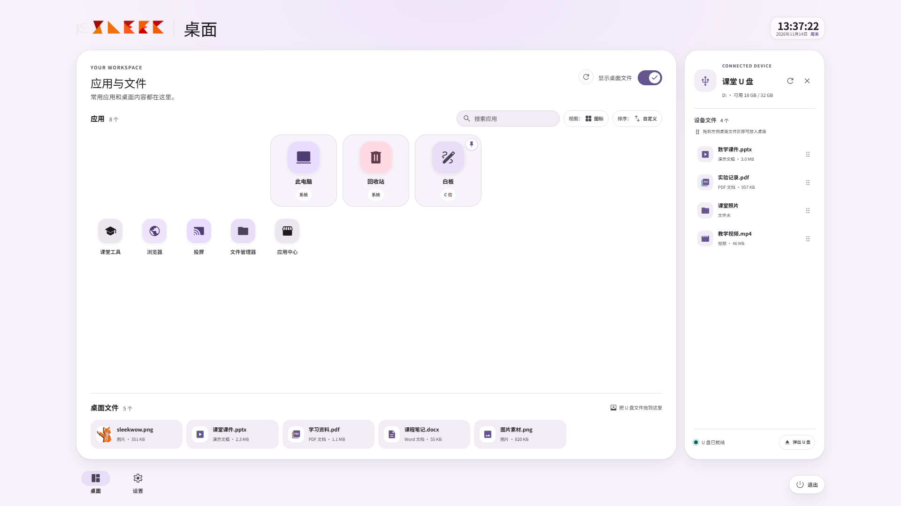

# reSleek Launcher

一个面向 Windows 的桌面启动器：把常用应用、桌面文件、U 盘内容、主题和系统设置收进一个 Material 3 Expressive 界面里。



## 功能

- **应用扫描与图标提取**：读取 Windows 开始菜单，优先用 Windows Shell（`IShellItemImageFactory`）提取快捷方式自定义图标、UWP/MSIX 和普通 exe 图标，保留 `System.Drawing` 作为兜底；Rust 进程缓存 + 前端 localStorage 缓存，首次扫描约 5 秒。
- **C 位**：此电脑、回收站固定；希沃白板 5 / Microsoft Edge 等可固定，也可以点图钉随时加入或移出。
- **两种应用视图**
  - 列表视图：按拼音首字母分组（`#`、A–Z），适合应用很多时快速查找。
  - 图标视图：默认按字母排序；可切到「排序：自定义」后拖动图标排序。
  - 两种视图都支持搜索。
- **桌面文件**：读取真实桌面目录（支持 OneDrive 重定向），点击用系统默认程序打开；拖到回收站即可移入回收站。
- **U 盘**：自动检测可移动磁盘；文件夹在应用内进入预览，不再打开 Explorer；文件可拖到桌面文件区复制；支持多分区 U 盘按整块物理磁盘安全弹出。
- **拖拽**：基于 pointer 事件和 `elementFromPoint`，兼容 WebView2，不依赖 HTML5 DataTransfer。
- **主题与壁纸**：Material 3 动态配色、壁纸取色、自定义背景图片、实时背景模糊、深色模式。
- **窗口与系统**：默认全屏、F11 切换、开机自启、右下角退出按钮。
- **右上角时钟**：显示日期、常见节假日 / 周末、秒数，可选毫秒和时钟背景；全部可在「时间显示」设置中开关。
- **防连点**：短时间内重复点击应用或文件，会弹出 Material 3 Expressive 弹窗提示「只需要点击一次即可」。
- **设置页**：Android 横屏式双栏布局，包含主题与壁纸、桌面行为、语言、开发者选项和关于。

## 技术栈

- Tauri 2 + Rust
- Vue 3 + TypeScript + Vite
- [`material`](https://md3.io) —— Material 3 Expressive 组件
- Material Symbols Rounded
- `tiny-pinyin` —— 中文应用名首字母分组

## 开发

需要 Windows 10/11、Node.js、Rust，以及 Tauri 的 Windows 构建依赖（WebView2、MSVC 等）。

```bash
npm install
npm run tauri dev
```

只在浏览器里预览 UI（使用演示数据）：

```bash
npm run dev
```

## 构建

```bash
npm run build
npm run tauri build
```

只生成 exe、不打包安装器：

```bash
npm run tauri -- build --no-bundle
```

## 目录

- `src/App.vue` —— 启动页、主界面、全屏快捷键、自定义背景层
- `src/views/DesktopView.vue` —— 应用 / 桌面 / U 盘数据编排
- `src/views/SettingsView.vue` —— 双栏设置页
- `src/components/DesktopCard.vue` —— 应用列表 / 图标视图、桌面文件、拖拽
- `src/components/DeviceCard.vue` —— U 盘卡片、文件夹预览、弹出
- `src/components/ThemePicker.vue` —— 主题色、壁纸、模糊度
- `src/components/WowDialog.vue` —— 防连点 MD3E 弹窗
- `src/services/catalog.ts` —— 应用过滤、C 位、排序
- `src/services/backend.ts` —— Tauri 命令封装
- `src-tauri/src/lib.rs` —— 应用扫描、文件操作、弹出 U 盘等命令
- `src-tauri/scripts/` —— PowerShell 扫描 / 弹出脚本

## 说明

- 浏览器预览（`npm run dev`）使用演示应用和文件；在 Tauri 里才读取真实系统数据。
- 应用扫描和图标提取依赖 Windows PowerShell；首次扫描会慢一点。
- U 盘文件夹预览和弹出使用新增的 Tauri 命令，修改 Rust 后需要重启 `tauri dev`。
- `public/assets/sleekwow.png` 是项目里的示例彩蛋图片；如果不希望公开，可以替换成自己的图片或删除相关逻辑。
- 第三方图标字体许可见 `public/licenses/material-symbols-LICENSE.txt`。
